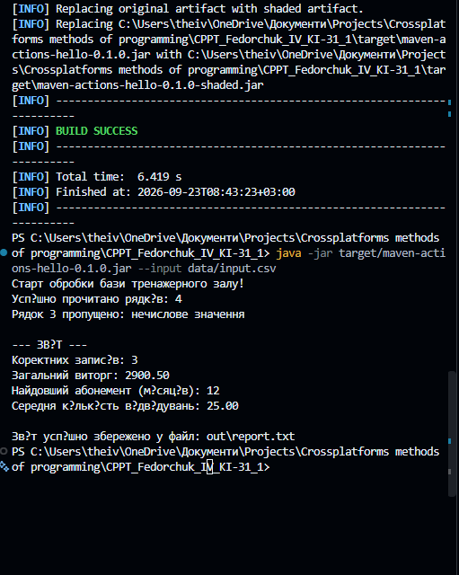

# Lab 1 — Java project setup and basic data processing

## 1. Topic, number and variant

| | |
|---|---|
| Lab | 1 — Infrastructure of a cross-platform Java project |
| Variant | 20 — gym memberships |
| Author | Fedorchuk I. V., group KI-31 |
| Development OS | Windows 11 |
| CI | GitHub Actions: Ubuntu, Windows, macOS |
| Code state | tag [`v1.0.0`](https://github.com/anc1eeent/CPPT_Fedorchuk_IV_KI-31_1/tree/v1.0.0), pull request [#5](https://github.com/anc1eeent/CPPT_Fedorchuk_IV_KI-31_1/pull/5) |

## 2. Goal

Build the full path from an empty repository to a console program that is built,
tested, checked by a static analyser and packaged the same way on Windows, macOS and Ubuntu.

Result: a Maven project with the Maven Wrapper, JUnit 5, SpotBugs and an executable JAR;
GitHub Actions builds it on three operating systems; the program reads the gym CSV file,
skips invalid rows with the line number and reason, and writes the report to the console and a file.

## 3. Task

Every CSV row describes one membership:

```text
client;plan;months;visits;price
Іван Федорчук;Безліміт;12;45;1500.50
```

| Field | Meaning | Rule |
|---|---|---|
| `client` | client name | not empty |
| `plan` | tariff name | not empty |
| `months` | duration in months | whole number, not negative |
| `visits` | number of visits | whole number, not negative |
| `price` | price paid | number, not negative |

Report indicators of variant 20:

1. number of valid records;
2. total revenue — sum of prices;
3. longest membership — maximum of months;
4. average number of visits — `double` division, printed only when there are valid records.

## 4. Program structure

```text
pom.xml                         Maven project: Java 21, JUnit 5, SpotBugs, Shade
.github/workflows/ci.yml        build matrix for three operating systems
data/input.csv                  sample data, UTF-8, with an invalid row
src/main/java/ua/lpnu/kzp/Main.java
src/test/java/ua/lpnu/kzp/      JUnit 5 tests
```

Data flow in `Main` (state at `v1.0.0`):

```text
data/input.csv → Files.readAllLines(UTF-8) → split(";", -1) → field count check
  → Integer.parseInt / Double.parseDouble → negative value check
  → counters (valid, revenue, visits, max months) → String.format(Locale.ROOT)
  → console + out/report.txt
```

## 5. Infrastructure

| Tool | Role |
|---|---|
| Maven Wrapper (`mvnw`, `mvnw.cmd`) | downloads Maven 3.9.11, so every machine builds with the same version |
| JUnit 5 (`junit-jupiter`, test scope) | unit tests, run in the `test` phase |
| SpotBugs (`check` in `verify`) | static analysis of bytecode; a found bug fails the build |
| Maven Shade | executable JAR with `Main-Class` in the manifest |
| GitHub Actions | `mvnw verify` on `ubuntu-latest`, `windows-latest`, `macos-latest`; the JAR is uploaded as an artifact |

Commands:

```powershell
.\mvnw.cmd clean verify          # compile → test → package → SpotBugs
java -jar target\<name>.jar      # run
```

## 6. GitHub Issues and pull request

| Issue | Change | Merged in |
|---|---|---|
| [#1](https://github.com/anc1eeent/CPPT_Fedorchuk_IV_KI-31_1/issues/1) `infra` | Maven project and SpotBugs | PR #5 |
| [#2](https://github.com/anc1eeent/CPPT_Fedorchuk_IV_KI-31_1/issues/2) `infra` | GitHub Actions CI | PR #5 |
| [#3](https://github.com/anc1eeent/CPPT_Fedorchuk_IV_KI-31_1/issues/3) `feature` | business logic of variant 20 | PR #5 |
| [#4](https://github.com/anc1eeent/CPPT_Fedorchuk_IV_KI-31_1/issues/4) `docs` | documentation of Lab 1 | PR #5 |

## 7. Examples

Input (`data/input.csv` at `v1.0.0`):

```text
Іван Федорчук;Безліміт;12;45;1500.50
Петро Коваль;Ранковий;3;10;500.00
Олена Петрівна;Разовий;помилка;1;150.00
Марія Іванівна;Вечірній;6;20;900.00
```

Console output (`v1.0.0`, original Ukrainian output):

```text
Старт обробки бази тренажерного залу!
Успішно прочитано рядків: 4
Рядок 3 пропущено: нечислове значення

--- ЗВІТ ---
Коректних записів: 3
Загальний виторг: 2900.50
Найдовший абонемент (місяців): 12
Середня кількість відвідувань: 25.00
```



The same text is written to `out/report.txt`.

## 8. Testing

- `mvnw verify` passes locally and in GitHub Actions on all three operating systems.
- At `v1.0.0` the project had one smoke test that only proved the test setup works.
- Real tests of parsing and indicators were added later: the invalid-row and indicator tests
  of the cleanup (`v1.2.1`, Issues #17 and #19) check exactly the Lab 1 values `3 / 2900.50 / 12 / 25.00`.

CI runs: [Actions → Java CI](https://github.com/anc1eeent/CPPT_Fedorchuk_IV_KI-31_1/actions/workflows/ci.yml).

## 9. Documentation

Javadoc describes the `Main` class and the `main` method. README explains the purpose of the
project and the commands; this report describes the structure and the results.

## 10. Academic integrity

- **Tool:** Google Gemini, used as a "Senior DevOps mentor" consultant.
- **AI contribution:** help with `pom.xml`, `ci.yml` and SpotBugs configuration; explanations of the
  Maven lifecycle; refactoring suggestions for the processing loop.
- **Author's contribution:** local environment, all commands, the processing loop and validation,
  GitHub Issues and the pull request.
- **Later corrections (v1.2.1, Claude by Anthropic):** the Lab 1 requirements that were missing at
  `v1.0.0` — `--help`, `--input`, `--output`, one version in `pom.xml`/tag/`--version`,
  `.gitattributes`, `.editorconfig`, Issue forms, PR template, AI role files and invalid rows
  of every kind — were added in PR #21 (Issues #13, #14, #18, #19, #20).
- I understand every line of the code and configuration and can explain them.

## 11. Answers to the control questions

1. **`pom.xml`** describes the project for Maven: coordinates (groupId, artifactId, version),
   Java version, encoding, dependencies and plugins with the phases they are bound to.
2. **`test`** compiles and runs the unit tests; **`package`** additionally builds the JAR;
   **`verify`** runs everything before it and then the checks bound to it — SpotBugs in this project.
3. **Maven Wrapper** pins the Maven version in the repository and downloads it, so the build is the
   same on any machine and in CI without installing Maven.
4. **`main`** is the entry point: the JVM calls it first and passes the command-line arguments in `args`.
5. A **primitive** (`int`, `double`) holds the value itself and cannot be `null`; **`String`** is an
   immutable object referenced by a variable.
6. `int / int` drops the fraction (`76 / 3 == 25`), so the **average** must be computed in `double`.
7. **`Integer.parseInt("abc")`** throws `NumberFormatException`; the program must catch it and report the row.
8. A **silently skipped row** hides a data error: the report becomes wrong and nobody knows why.
   The user must see the line number and the reason.
9. **`split(";", -1)`** keeps empty trailing fields, so `"a;b;"` gives three fields, not two.
10. **`Path.of("data", "input.csv")`** builds the path with the separator of the current OS;
    a hard-coded `"data\\input.csv"` breaks on Linux and macOS.
11. **`StandardCharsets.UTF_8`** makes reading and writing independent of the OS default encoding,
    so Ukrainian text is not corrupted.
12. **`%n`** prints the line separator of the current OS; `\n` is always LF.
13. In variant 20 we check: field count, non-empty client and plan, numeric months, visits and price,
    and that the numbers are not negative.
14. A test with a sum that does not divide evenly (for example 76 visits over 3 memberships must give
    25.33) catches integer division; a test with an empty file catches division by zero.
15. A **static analyser** finds typical defects (null dereference, ignored results, unsafe constructors)
    without running the program.
16. **GitHub Actions** builds and tests every push and pull request on three operating systems and
    publishes the JAR.
17. A **defect Issue** has steps to reproduce, the expected result and the actual result.
18. The **academic integrity** section names the AI tool, roles, prompts, accepted and rejected
    suggestions, fixed mistakes, own contribution and confirms understanding of all code.
19. The **DevOps** agent advises on Maven, the wrapper, SpotBugs and CI; the **Validator** looks for edge
    cases and wrong results and describes them as bugs.
20. The hardest line was `split(";", -1)`: without `-1` an empty last field disappears and the field
    count check gives a misleading error.

## 12. Conclusions

The project builds, tests, analyses and packages itself with one command on three operating systems,
and the program produces the four indicators of variant 20. The Maven project, the CI pipeline and
the CSV processing became the base for Lab 2, where the parallel variables were replaced by a class.
